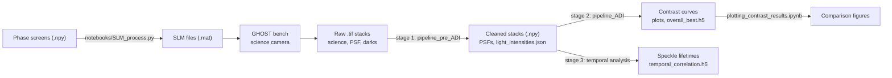

# High-contrast imaging analysis for the GHOST bench

Analysis code for comparing adaptive-optics (AO) controllers on ESO's GHOST test bench. Turbulence phase screens are played on the bench's spatial light modulator (SLM). The coronagraphic science camera records the residual speckle field, and this repository turns those recordings into:

- **contrast curves** (detection limits): fake planets are injected into the sequence, which is then reduced with angular differential imaging (raw, classical ADI, PCA), with the statistics done by [applefy](https://github.com/markusbonse/applefy);
- **speckle lifetimes**: how quickly the speckle pattern decorrelates in time.

Both are compared between the **integrator** (`int`) and the **predictive** (`pred`) controller across seeing and wind-speed conditions.

---

## Workflow



| Stage | Code | What it does | Details |
|---|---|---|---|
| 1. Pre-processing | [src/pipeline_pre_ADI/](src/pipeline_pre_ADI/) | Aligns frames on the satellite speckles, finds the star centre, subtracts darks, crops, and rejects bad frames with PCA + MAD | [README](src/pipeline_pre_ADI/README.md) |
| 2. Contrast curves | [src/pipeline_ADI/](src/pipeline_ADI/) | Injects fake planets, runs raw / cADI / PCA reductions on the GPU, computes contrast curves and grids with applefy | [README](src/pipeline_ADI/README.md) |
| 3. Developments and  analysis | [analysis_pre_process.py](src/pipeline_pre_ADI/notebooks/analysis_pre_process.py), [temporal_decorrelation_clean.ipynb](notebooks/temporal_decorrelation_clean.ipynb) | Frame-to-frame correlation per image region, speckle lifetimes, int vs pred | Notebook introduction |

---

## Repository layout

```text
.
├── src/                              # installed as one package (pyproject.toml)
│   ├── pipeline_pre_ADI/             # stage 1: raw .tif -> cleaned .npy stacks
│   │   ├── pre_process/              #   centering, pre_processing, correlation, plotting
│   │   └── notebooks/                #   run.py + config_pre_process.yaml, analysis_pre_process.py, make_plots.ipynb
│   ├── pipeline_ADI/                 # stage 2: contrast curves
│   │   ├── contrast_pipeline/        #   post_processing (load_config, run_pipeline), PCA and raw-contrast reductions, plotting, cli
│   │   ├── config_files/             #   default_values.yaml, template.yaml, ghost.yaml, ghost_ref.yaml
│   │   └── run.py                    #   scripted parameter sweeps
│   └── utils/
│       ├── naming.py                 #   run names, name parsing, plot titles, data loaders
│       └── statistics.py             #   FWHM, apertures, correlation and information measures
├── notebooks/                        # analysis and exploration (see "Notebooks")
│   ├── utils/                        #   helper modules for the older notebooks (functions.py, HCIPY.py)
│   ├── SLM_process.py                #   phase-screen cubes -> SLM .mat files
│   └── light_intensities.json        #   satellite-speckle and PSF intensities per run
├── config/PynPoint_config.ini        # PynPoint header and settings, for the PynPoint-based notebooks
├── view_GHOST_screens.ipynb
├── pyproject.toml
└── requirements.txt                  # pinned environment (Python 3.12, torch with CUDA 13)
```

The following are ignored by git and must be provided separately (see `.gitignore`):

```text
data/            # raw bench data and processed stacks
applefy_fixed/   # patched applefy fork, required by pipeline_ADI
env_hci/, .venv/ # virtual environments
results/         # pipeline outputs (also *.png, *.fits, *.hdf5, *.mp4, *.gif)
```

---

## Installation

Requires Python 3.12. A CUDA GPU is strongly recommended: the PCA, derotation and fake-planet injection run on torch.

```bash
python3.12 -m venv env_hci
source env_hci/bin/activate
pip install -r requirements.txt

# Patched applefy: replaces the PyPI applefy 0.1.2 installed above
pip install -e ./applefy_fixed

# This repository: makes pipeline_pre_ADI, pipeline_ADI and utils importable
pip install -e .
```

`applefy_fixed/` is not part of this repository. It is a fork of [markusbonse/applefy](https://github.com/markusbonse/applefy) (branch `improve-photometry`) that also contains the `applefy_extensions` package (`ContrastFast`, the GPU fake-planet injection). The PyPI `applefy==0.1.2` lacks that package, so without the fork `pipeline_ADI` fails at import. Place a copy of the fork at the repository root before running `pip install -e ./applefy_fixed`.

Check the install:

```bash
python -c "import pipeline_ADI.contrast_pipeline.post_processing, pipeline_pre_ADI.pre_process.pre_processing, utils.naming"
```

For the notebooks, select `env_hci/bin/python` as the interpreter in VS Code (*Python: Select Interpreter*), or register it as a Jupyter kernel with `python -m ipykernel install --user --name env_hci`.

---

## Data

Data is not committed. The configs expect this layout under `data/ghost_images/`:

| Folder | Content |
|---|---|
| `phase_screens_SLM/<date>/` | Raw bench recordings (`.tif`): science (`*coro*`), PSF (`*no_coro*`), darks (`darks_img*`, `darks_psf*`) |
| `phase_screens_send/` | Phase-screen sets sent to the SLM (`SLM_phase_screens_<ro>ro_<ws>ws[_<key>key].mat`) |
| `<run_name>/` | Pre-processing output: cleaned science stacks, `psf_*.npy`, optionally `master_psf.npy` |

### File naming

Run files follow `<algo>_<ro>ro_<ws>ws[_<key>key][_<count>].npy`, for example `pred_7ro_20ws_24key_1-4.npy`. [utils/naming.py](src/utils/naming.py) builds (`run_name`), parses (`section_name`, `reorder_name`), titles (`titling`) and loads (`load_stack`) these names.

| Part | Meaning |
|---|---|
| `algo` | `int` integrator, `pred` predictive controller, `OL` open loop, `CL` closed loop. A `psf_` prefix marks a PSF |
| `<ro>ro` | Seeing in tenths of an arcsecond (`7ro` = 0.7″) |
| `<ws>ws` | Wind speed in m/s |
| `<key>key` | Which phase-screen set was played (matches the `_<key>key.mat` file) |
| `count` | Repeat index, or the merged range after stacking (`1-4` = repeats 1 to 4 concatenated) |

---

## Running

### 1. Pre-processing

Edit [config_pre_process.yaml](src/pipeline_pre_ADI/notebooks/config_pre_process.yaml) (input folder, output roots, DITs, crop radius, outlier thresholds), then:

```bash
cd src/pipeline_pre_ADI/notebooks
python run.py --config config_pre_process.yaml

# Override any key without editing the file, e.g. a dry run
python run.py --config config_pre_process.yaml --set modes.save_outputs=false
```

Outputs:

- `<data_root>/<run_name>/`: cleaned science stacks and PSFs (`.npy`). Numbered repeats are merged into `<name>_1-4.npy`-style stacks according to `stacking.groups`.
- `<analysis_root>/<run_name>/`: outlier PCA plots, `light_intensities.json`, `outlier_diff.h5`, optionally `raw_contrast.h5`, and a copy of the config used (`config_used.yaml`).

`run_pre_processing.py` in the same folder is the earlier version of this runner, with its settings hard-coded at the top. `analysis_pre_process.py` computes the region-wise temporal correlation of every `int`/`pred` run and appends it to `temporal_correlation.h5` in the data folder.

### 2. Contrast curves

The defaults path (`config_files/default_values.yaml`) and the output paths in the configs (`results/...`) are relative to the working directory, so run from `src/pipeline_ADI`:

```bash
cd src/pipeline_ADI
python -m pipeline_ADI.contrast_pipeline.cli -c config_files/ghost.yaml
```

To set up a new experiment, copy [template.yaml](src/pipeline_ADI/config_files/template.yaml), which documents every key. Any key you leave out is taken from [default_values.yaml](src/pipeline_ADI/config_files/default_values.yaml). Set `experiment.ori_folder` to a pre-processing output folder, and give each dataset (usually `int` and `pred`) its `science_file` and `psf_file` in that folder. `ghost.yaml` sets `fake_planet.device: cuda`. Change it to `auto` or `cpu` on a machine without a GPU.

From Python:

```python
from pipeline_ADI.contrast_pipeline.post_processing import load_config, run_pipeline, run_from_checkpoint

config = load_config("config_files/ghost.yaml")
run_pipeline(config)                     # inject fake planets, reduce, compute contrast
run_from_checkpoint(config, plot=True)   # recompute contrast from saved residuals only
```

[run.py](src/pipeline_ADI/run.py) runs sweeps: it loads a config, changes it in Python (files, DIT binning, PCA components) and calls `run_pipeline` in a loop. Edit the block at the bottom, then run `python run.py`.

Outputs go to `results/fake_planets/<experiment>/...` (checkpoints and residuals) and `results/contrast/<experiment>/...` (plots, grid animations, `overall_best.h5`). See the [pipeline README](src/pipeline_ADI/README.md#outputs) for details.

### 3. Analysis

Open the notebooks listed below with the `env_hci` kernel. Most of them set their data paths in the first cells.

### SLM phase screens

```bash
python notebooks/SLM_process.py -i screens_a.npy screens_b.npy
```

Converts phase-screen cubes of shape `(T, 1152, 1152)` to `uint8`, zero-pads them into the 1920 × 1152 SLM frame and saves them as MATLAB v7.3 files (variable `turb`) next to the input.

---

## Notebooks

### Current

These import from the installed `src` packages.

| Notebook | Purpose |
|---|---|
| [temporal_decorrelation_clean.ipynb](notebooks/temporal_decorrelation_clean.ipynb) | Speckle temporal decorrelation and lifetimes, int vs pred |
| [plotting_contrast_results.ipynb](notebooks/plotting_contrast_results.ipynb) | Saved best contrast curves and post-processing gains |
| [satellite_speckle_psf.ipynb](notebooks/satellite_speckle_psf.ipynb) (+ `.py`) | Satellite-speckle photometry for flux calibration, builds `master_psf.npy` and `light_intensities.json` |
| [Fits_visualisation.ipynb](notebooks/Fits_visualisation.ipynb) | Exports phase screens, pre-processed cubes and ACF maps to FITS |
| [pre_processing_more_and_analysis.ipynb](notebooks/pre_processing_more_and_analysis.ipynb) | Development of the waffle and coronagraph-mask centring, spatial correlation, raw contrast |
| [Speckle_linearity.ipynb](notebooks/Speckle_linearity.ipynb) | Speckle linearity checks |
| [make_plots.ipynb](src/pipeline_pre_ADI/notebooks/make_plots.ipynb) | Visualises pre-processed data |

### Simulation (HCIPy)

| Notebook | Purpose |
|---|---|
| [HCIPY_tests.ipynb](notebooks/HCIPY_tests.ipynb) | VLT pupil, coronagraph and atmospheric aberrations simulated with HCIPy |
| [HCIPY_post_processing.ipynb](notebooks/HCIPY_post_processing.ipynb) | Simulated frames from int / pred phase screens, contrast curves with applefy |

### Legacy

These were written against the layout before the code moved into `src/` and are kept for reference. They import `utils.functions`, `utils.pre_processing` or a top-level `functions`. With the package installed, `utils` resolves to `src/utils`, so these imports fail until they are updated (or `notebooks/utils` is added to `sys.path` for `functions`). `HCIPY_post_processing.ipynb` also imports `functions` this way.

| Notebook | Purpose |
|---|---|
| [pre_processing_initial_setting_up.ipynb](notebooks/pre_processing_initial_setting_up.ipynb) | Source stability, display-setting effects, first centring and cropping, speckle diversity |
| [GHOST_post_processing.ipynb](notebooks/GHOST_post_processing.ipynb) | First contrast curves on GHOST data |
| [TTest_issue.ipynb](notebooks/TTest_issue.ipynb) | Investigation of the t-test in contrast grids, PCA vs cADI |
| [view_GHOST_screens.ipynb](view_GHOST_screens.ipynb) | Loading GHOST images, optimal PCA rank, post-processing |
| `post_processing_contrast.py`, `post_processing_fastcontrast.py`, `post_processing_fastcontrast_loop.py` | Script predecessors of `pipeline_ADI` |

---

## Things to know

- **Absolute paths.** Configs, `run.py` scripts and notebooks use paths under `/home/aosimul/noah/`. Update them when moving the project.
- **Acquisition window.** The satellite-speckle alignment mask and the speckle-intensity aperture at (102, 172) are hard-coded for a 200 × 200 px window with its upper-left corner at (836, 342) on the GHOST science camera. A different windowing needs new values in [centering.py](src/pipeline_pre_ADI/pre_process/centering.py) and [pre_processing.py](src/pipeline_pre_ADI/pre_process/pre_processing.py).
- **Deleted outputs.** The contrast pipeline deletes and recreates each dataset's `results/fake_planets/...` folder on every run. In pre-processing, `modes.start_over: true` deletes the output data folder, and `stacking.delete_originals: true` deletes the numbered stacks after merging. Copy results you want to keep.
- **Flux normalisation.** Pre-processing can normalise twice (after centring and after outlier rejection). Multiply both constants to recover raw counts. In the contrast pipeline the PSF flux is set through `psf_factor` / `dit_psf`, using the satellite intensities in `light_intensities.json`.
- Module-level caveats are listed under *Known issues* in the [pre-processing](src/pipeline_pre_ADI/README.md#known-issues--things-to-check) and [contrast](src/pipeline_ADI/README.md#known-issues--things-to-check) READMEs.

---

## Built on

- [applefy](https://github.com/markusbonse/applefy): contrast curves and grids, t-test and parametric bootstrap ([Bonse et al. 2023](https://iopscience.iop.org/article/10.3847/1538-3881/acc93c/meta))
- [fours](https://pypi.org/project/fours/): GPU field-rotation model and the cADI / PCA applefy wrappers
- [HCIPy](https://hcipy.org): optical simulations
- [VIP](https://github.com/vortex-exoplanet/VIP) and [PynPoint](https://pynpoint.readthedocs.io): used in some notebooks
- numpy, scipy, torch, astropy, photutils, scikit-image, scikit-learn, pandas, h5py, tifffile, matplotlib
