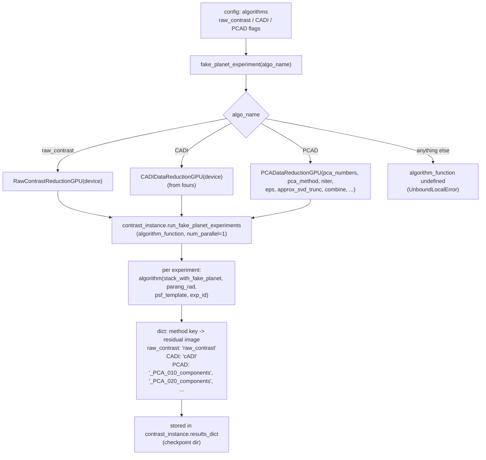
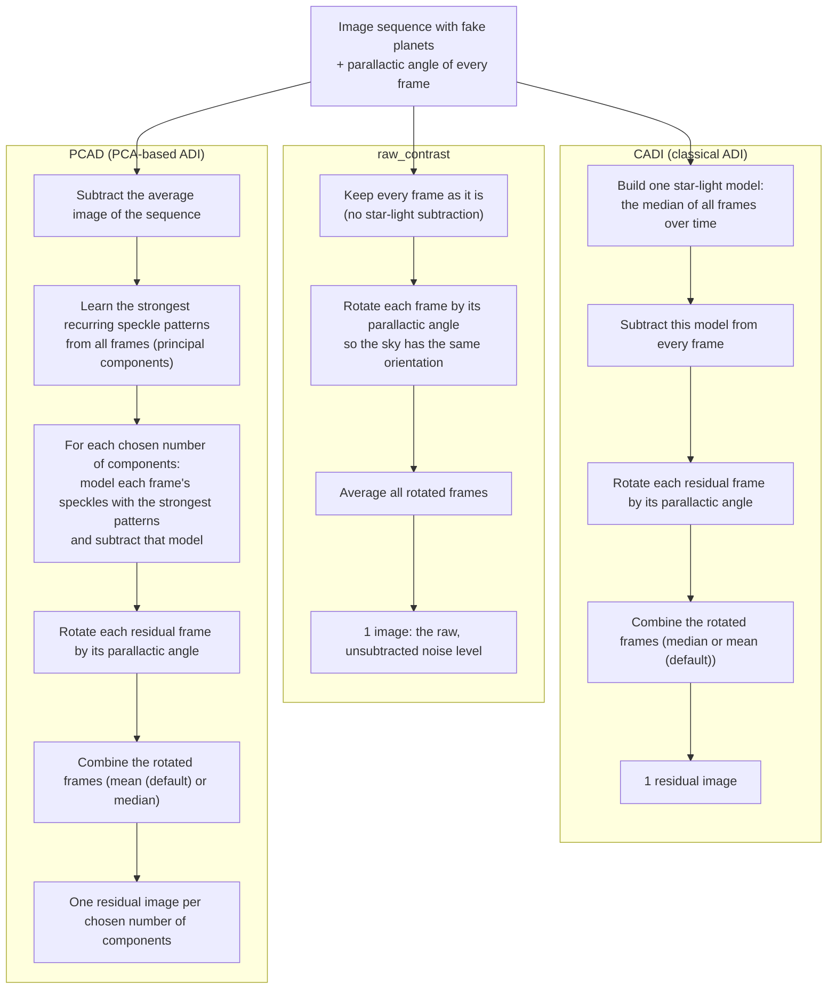
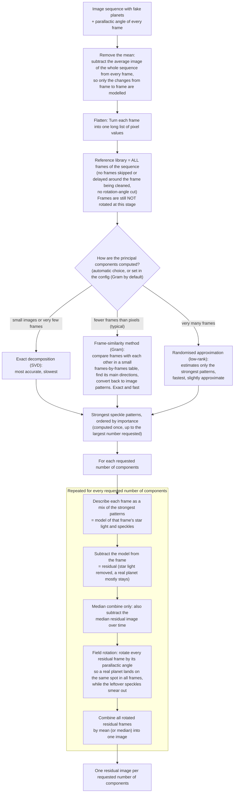
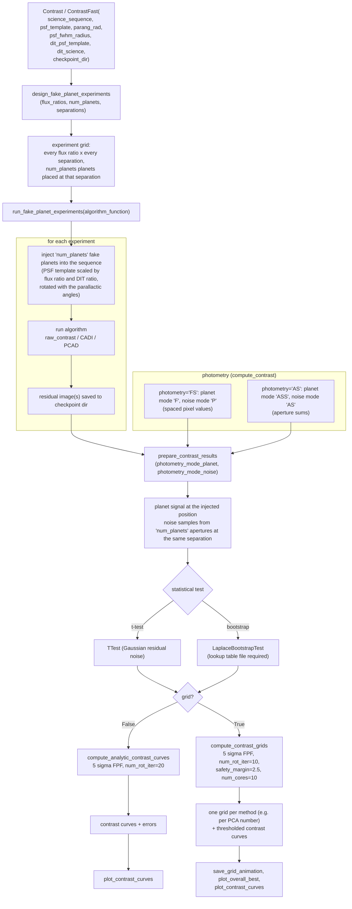

# Contrast-Curve Pipeline (fake-planet injection)

Computes detection-limit (contrast) curves for high-contrast imaging sequences by injecting fake planets into the science cube, running PSF-subtraction algorithms (e.g. PCA, cADI) and evaluating detection significance with `applefy`.

Entry points:

| Function | Purpose |
|---|---|
| `load_config(config_path, defaults_path)` | Load experiment YAML, merge over default values set by the default YAML, validate |
| `run_pipeline(config)` | Full run: build datasets, inject planets, run algorithms, compute and plot contrast |
| `run_from_checkpoint(config, plot=False)` | Rebuild contrast results from saved residuals, no re-computation of the fake-planet experiment |

---

## Block diagram

```mermaid
flowchart TD
    A["experiment.yaml"] --> C["load_config"]
    B["config_files/default_values.yaml"] --> C
    C --> C1["deep_merge_dicts<br/>(experiment overrides defaults)"]
    C1 --> C2["_validate_required_fields<br/>(sections, fields, >=1 dataset enabled)"]
    C2 --> D["run_pipeline(config)"]

    D --> E["For each enabled dataset: build_dataset"]

    subgraph BD["build_dataset"]
        E1["Load .npy science file(s)<br/>concatenate if list"] --> E2["Optional zoom_to_peak<br/>(radius_sc)"]
        E2 --> E3{"psf_file given?"}
        E3 -- yes --> E4["Load external PSF"]
        E3 -- no --> E5["PSF = sum of first<br/>dit_psf / dit_science frames"]
        E4 --> E6["Scale by psf_factor<br/>zoom_to_peak (radius_psf)"]
        E5 --> E6
        E6 --> E7["Bin frames by dit_factor<br/>dit_science *= dit_factor"]
        E7 --> E8["Truncate to science_frames"]
        E8 --> E9["FWHM = calculate_fwhm(psf)"]
    end

    E --> E1
    E9 --> F["Parallactic angles<br/>angle_file (.npy/.csv) or linspace(start, end)"]
    F --> G["Separations = k * FWHM * separation<br/>up to max_separation * centre"]
    G --> H["Reset output dir<br/>results/fake_planets/exp/file"]
    H --> I["ContrastFast(...)<br/>design_fake_planet_experiments<br/>(flux ratios, n planets, separations)"]
    I --> J["fake_planet_experiment<br/>first algorithm"]
    J --> K["fake_planet_experiment<br/>remaining algorithms<br/>(results_dict merged)"]
    K --> L{"contrast.enabled?"}
    L -- no --> Z["Done: residuals saved on disk"]
    L -- yes --> M["Load raw contrast from HDF5<br/>(optional)"]
    M --> N{"flux_ratio_mag is a list?<br/>(grid mode)"}
    N -- yes --> O["compute_contrast(grid=True)"]
    O --> P["Best sigma over PCA grids<br/>+ best PCA number maps"]
    P --> Q["save_grid_animation<br/>plot_overall_best (sigma, PCA)<br/>plot_contrast_curves"]
    Q --> R["compute_contrast(grid=False)"]
    N -- no --> R
    R --> S["plot_contrast_curves<br/>analytical + errors"]
    S --> T{"save_best?"}
    T -- yes --> U["overall_best.h5<br/>(key = file_name + extrasubname)"]
    T -- no --> Z2["Done"]
    U --> Z2

    D2["run_from_checkpoint"] -.-> E
    E9 -.-> V["Contrast.create_from_checkpoint_dir<br/>(reads saved residuals)"]
    V -.-> W["compute_contrast<br/>(+ plots if plot=True)"]
```

Dotted path = `run_from_checkpoint` (reuses the same `build_dataset`, skips injection and algorithm runs).

---

## Stages in detail

1. **Configuration.** Defaults and experiment YAML are deep-merged (nested dicts merged key by key, everything else overridden). Validation requires the sections `experiment`, `datasets`, `instrument`, `algorithms`, `fake_planet`, and at least one dataset with `enabled: true`.
2. **Dataset building.** Science cube(s) are loaded from `experiment.ori_folder`. The PSF either comes from `psf_file` or is the sum of the first `dit_psf / dit_science` science frames (this is relevant for non-corotographic sequences). Optional steps: crop around the peak, PSF scaling (mutualised to the entire reference psf), temporal binning by `dit_factor` (DIT scales accordingly), truncation to `science_frames`. FWHM is measured from the PSF.
3. **Geometry.** Parallactic angles are loaded from file or generated linearly. Fake-planet separations are spaced by `FWHM * separation`, out to `max_separation` times the image centre radius.
4. **Fake-planet experiment.** The output directory is **deleted and recreated** for each dataset. `ContrastFast` designs the injection experiment, then each enabled algorithm is run in turn. Results from earlier algorithms are merged into `results_dict`.
5. **Contrast curves.** If `contrast.enabled`:
   - *Grid mode* (when `flux_ratio_mag` is a list): per-PCA-component significance grids, an animation, an overall-best significance map and an overall-best PCA-number map. 
   - *Analytical curves*: always computed with `grid=False`, plotted with error bars, and the raw_contrast, cADI and best PCA curves are optionally saved to `overall_best.h5`.

## Post-processing methods

Each algorithm is a class implementing Applefy's `DataReductionInterface`. For every fake-planet experiment Applefy calls it with the same four inputs and expects a dict of residual images back. The raw_contrast is new, the cADI method is imported from the fours Applefy wrapper, and the PCAD was is a mix of a lot of methods, combined here, and explained later in this section.

### The three methods side by side

| Method | What it removes | Output key(s) | Role |
|---|---|---|---|
| `raw_contrast` | Nothing, only derotation and mean | `raw_contrast` | Baseline: contrast without any speckle subtraction |
| `CADI` | Temporal median of the sequence | `cADI` | Classical ADI reference |
| `PCAD` | Projection onto the first *k* principal components | `_PCA_<k>_components` (k zero-padded to 3 digits) | Main algorithm, evaluated for each k in `fake_planet.components` |

In grid mode the pipeline drops `cADI` and `raw_contrast` before computing the "overall best" maps, so only the PCA entries compete. It extracts the PCA number from the key with `key.split("_")[2]`, which relies on the key format above (empty `special_name`).

### PCAD in detail (high-level)

Points to note:

- **Reference frames:** every frame of the sequence is part of the reference library. The code does not exclude neighbouring frames in time or frames with a small rotation difference, so there is no frame delay. A real planet can therefore be partly subtracted (self-subtraction), which is exactly what the fake-planet injection measures.
- **Order of operations:** mean removal, pattern learning and subtraction all happen on the recorded frames fed into the algorithm. Derotation according to parallactic angles comes only after subtraction.
- **Computed once:** the patterns are learned a single time for the largest requested number. Smaller numbers simply use the first few patterns.

## Applefy workflow (how the contrast curve is produced)

The injection, photometry and statistics are done by Applefy (`Contrast` and @Markus Bonse Eristool `ContrastFast` subclass) following this order:

Steps:

1. **Design.** Choose flux ratios (converted from magnitudes), number of fake planets and separations (multiples of the FWHM).
2. **Inject and reduce.** For each flux ratio and separation, fake planets built from the PSF template are added to the sequence and the chosen algorithm is run. Each algorithm's residuals are stored under its method key.
3. **Measure.** For each residual, the planet signal at the known position and the noise at the same separation are measured with the chosen photometry mode.
4. **Test.** The statistical test converts signal and noise into a false-positive fraction (FPF). The default threshold for a true detection is `gaussian_sigma_2_fpf(5)`, i.e. 5 sigma.
5. **Contrast.** In analytic mode, the contrast at each separation is the flux ratio that reaches the threshold, with an uncertainty from repeating the noise measurement over `num_rot_iter` aperture rotations (20 times by default was found reliable). In grid mode, the FPF is evaluated over the whole flux-ratio and separation grid per method, and the curves come from thresholding it.

## Outputs

| Path | Content |
|---|---|
| `{fake_planet.path}/{experiment.name}/{file_name}{extrasubname}/` | Checkpoints and residuals |
| `{contrast.path}/{experiment.name}/{arcsec}_{windspeed}_{key}/` | Plots and grid animations |
| `{contrast.path}/{experiment.name}/overall_best.h5` | Best analytical curves (if `save_best`) |

## Configuration keys used

- `experiment`: `name`, `ori_folder`, `extrasubname`
- `instrument`: `dit_science`, `dit_psf`, `radius_psf`, `radius_sc`, `dit_factor`, `science_frames`, `psf_factor`, `pixel_size`
- `datasets.<name>`: `enabled`, `science_file` (str or list), optional `psf_file`, `dit_science`, `dit_psf`, `psf_factor` (dataset values override instrument values)
- `algorithms.<name>`: boolean flags
- `fake_planet`: `flux_ratio_mag` (scalar or list), `num_fake_planets`, `components`, `separation`, `max_separation`, `path`, `device`, `scaling_factor`, `angle_file` or `angle_start`/`angle_end`
- `contrast`: `enabled`, `raw_contrasts`, `photometry`, `test`, `range_constrast_y`, `path`, `save_best`

## Requirements

- Python 3.12 or newer (f-strings reuse the same quote type inside expressions).
- numpy, pandas, pyyaml, applefy, plus the project's own helpers (`ContrastFast`, `Contrast`, `fake_planet_experiment`, `compute_contrast`, `plot_*`, `save_grid_animation`, `section_name`, `zoom_to_peak`, `calculate_fwhm`, unit helpers `mag2flux_ratio`, `flux_ratio2mag`).

## Known issues / things to check

- `PCADataReductionGPU` stores `oversample` and `gram_threshold`, but never passes them to `pca_psf_subtraction_gpu`, so they have no effect. The fitter uses its own defaults (`oversample=10`, `gram_threshold=1.0`).
- `pca_psf_subtraction_gpu` defaults to `pca_method="gram"` while the class defaults to `"auto"`. The pipeline always passes `fp["pca_method"]`.
- `compute_contrast` only warns on an unrecognised `photometry` or `test` value, then fails later with an undefined variable. Raise an error instead.
- The bootstrap test loads `"file/to/lookup_table"`, a placeholder path.
- `num_parallel` is fixed to 1 in `fake_planet_experiment` and `num_cores=10` is fixed in grid mode.
- `compute_contrast` is documented as returning `contrast_curves_grid, contrast_grids` for the grid case, but the second value is the dict of grids per method, which is what `run_pipeline` indexes as `contrasts_output[1]`.
- `build_dataset` expects `zoom_to_peak` to return only an array. The version in the pre-processing module returns `(image, coords)`, so make sure the right one is imported.
- The `build_dataset` docstring does not list `ori_folder`, `psf_factor`, `science_frames`, `extrasubname`.
- Output directories are removed with `shutil.rmtree` before every run. Copy results you want to keep.
