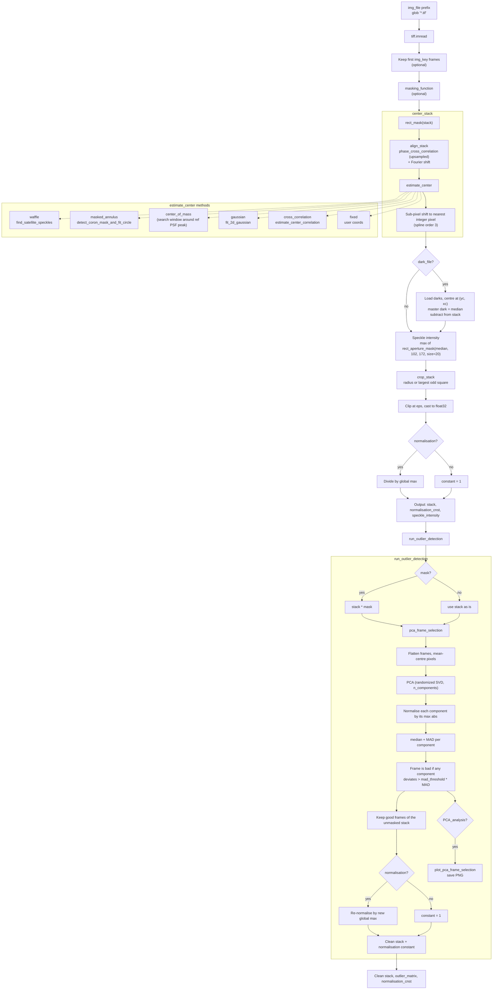
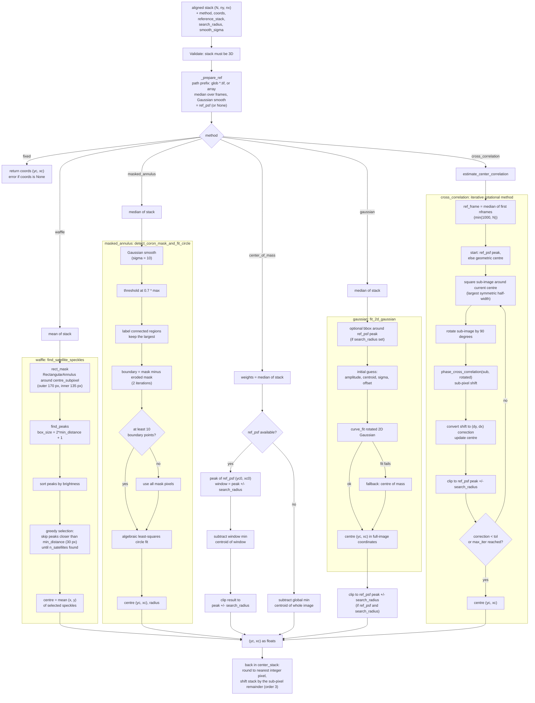

python -m venv env_hci
source env_hci/bin/activate
pip install -r requirements.txt
cd src/pipeline_ADI
pip install -e.

Then in VS Code:
Ctrl+Shift+P
Python: Select Interpreter
Choose /home/aosimul/noah/env_hci/bin/python

# Pre-Processing Pipeline (centering, dark subtraction, outlier rejection)

Prepares raw `.tif` image stacks for the ADI / contrast pipeline: aligns frames, finds the star centre, subtracts a dark, crops, normalises, and rejects bad frames using PCA with a MAD criterion.

Note: I rely on satellite speckle detection in my pre processing routine. I thus had to hard code code coordinates to locate them or at least define a searching area. For reference, I took my data acquisition defining a windowing in the Thorlabs software for the science camera on GHOST, of widths 200 by 200, with un upper left corder at (836, 342). This means the reference satellite speckle I used was located around (102,172) and I also defined a rectangular aperture to block out the center of the image and only show satellite speckles, with assumes that the data acquisition is somewhat centred on the source.

Entry points:

| Function | Purpose |
|---|---|
| `run_pre_processing(img_file, ...)` | Load, mask, align, centre, dark-subtract, crop, normalise. Returns `(stack, normalisation_cnst, speckle_intensity)` |
| `run_outlier_detection(stack_name, stack, ...)` | PCA-based bad-frame rejection and re-normalisation. Returns `(stack, outlier_matrix, normalisation_cnst)` |

Typical use: `run_pre_processing` then `run_outlier_detection` on its output.

---

## Block diagram

---

## Stages in detail

### 1. `run_pre_processing`
1. Read all `{img_file}*.tif` files; optionally keep the first `img_key` frames.
2. Apply `masking_function`, if given, to the whole sequence.
3. **Centre and align** (`center_stack`): frames are aligned to a reference built from `rect_mask(stack)` using `phase_cross_correlation` and a Fourier shift (preserves speckle statistics better than spline interpolation). The `rect_mask(stack)` was defined to only keep the satellite speckles which are reliable features on the GHOST bench. The star centre is then estimated and the stack is shifted so the centre lands on an integer pixel.
4. **Dark subtraction** (if `dark_file`): darks are shifted to the same centre (using `method="fixed"`), median-combined into a master dark and subtracted.
5. **Speckle intensity**: maximum of a small rectangular aperture on the median image. The aperture was defined according to the coordinates and the windowing I performed my data acquisition with.
6. **Crop** around the centre (using a defined size `radius`, or the largest square that fits).
7. **Normalise**: pixels clipped to at least `eps` to avoid zero values in the image, converted to float32, divided by the global maximum if `normalisation=True`.

### 2. Centre estimation methods (`method=`)

| Method | Idea | Notes |
|---|---|---|
| `waffle` (default in `center_stack`/`run_pre_processing`) | Fit centre from satellite (waffle) speckles in the mean image | `n_satellites` |
| `masked_annulus` (default in `estimate_center`) | Fit a circle to the coronagraph mask edge in the median image | |
| `center_of_mass` | Centroid of the median image, optionally in a window around a reference-PSF peak | `search_radius`, `smooth_sigma` |
| `gaussian` | 2D Gaussian fit on the median image | `search_radius` clamps the result |
| `cross_correlation` | Iterative rotational cross-correlation | needs `estimate_center_correlation`, uses `upsample_factor`, `max_iter`, `tol` |
| `fixed` | Use given `coords=(yc, xc)` | |

`reference_stack` may be an array or a path prefix (`{prefix}*.tif`, median-combined, Gaussian-smoothed).

#### Centering block diagram (`estimate_center` and `centering.py`)

### 3. `run_outlier_detection`
Frames are flattened and decomposed with PCA. In each component the median and MAD are computed. A frame is rejected if it lies beyond `mad_threshold` MADs in **any** of the `n_components` components. Rejection is decided on the (optionally masked) stack, but the output keeps the unmasked good frames, re-normalised. With `PCA_analysis=True`, a PC1 vs PC2 scatter plot is saved to `{PCA_plot_output}/{stack_name}.png`.

### 4. Helpers
- `zoom_to_peak(img, radius)`: crop a square around the brightest pixel, returns `(cropped, peak_coords)`.
- `radial_profile_pre(image, binsize)`: azimuthal mean and standard deviation about the geometric image centre.

## Key parameters

| Parameter | Default | Meaning |
|---|---|---|
| `method` | `"waffle"` | Centre estimation method |
| `radius` | `None` | Half-width of the crop (pixels) |
| `search_radius` | 7 | Allowed distance from the reference PSF peak |
| `smooth_sigma` | 3 | Gaussian smoothing of the reference PSF |
| `upsample_factor` | 100 | Sub-pixel precision for cross-correlation centering |
| `n_satellites` | 2 | Waffle spots used |
| `eps` | 1e-9 | Floor value, keeps pixels strictly positive |
| `n_components` | 5 | PCA components for outlier detection |
| `mad_threshold` | 5.0 | Rejection threshold in MADs |

## Requirements

numpy, scipy, scikit-image, scikit-learn, photutils, tifffile, matplotlib, pandas, `applefy`, and the project modules `utils.statistics`, `utils.naming` (`titling`), `pipeline_pre_ADI.pre_process.centering` (`rect_mask`, `rect_aperture_mask`, `find_satellite_speckles`, `detect_coron_mask_and_fit_circle`, `fit_2d_gaussian`, `estimate_center_correlation`).

## Known issues / things to check

- The speckle-intensity aperture is hard-coded: `rect_aperture_mask(median, 102, 172, size=20)`. The aperture was defined according to the coordinates and the windowing I performed my data acquisition with. It corresponds to the lower center satellite speckle, with a windowing of 200 by 200, with un upper left corder at (836, 342) on the GHOST science camera.
- Normalisation happens twice: once at the end of `run_pre_processing` and again after outlier rejection. The constant returned by `run_pre_processing` therefore does not convert back to raw counts on its own. Multiply both constants if you need absolute flux.
- `center_stack` docstring does not list `masked_annulus` or `gaussian`.
- `shift(..., mode="constant", cval=0)` after centring introduces zero-valued edges. Cropping removes them only if `radius` is small enough.
- The `rect_mask(stack)` mask used for alignement was defined to only keep the satellite speckles which are reliable features on the GHOST bench. It also corresponds to my data acquisition, with a windowing of 200 by 200, with un upper left corder at (836, 342) on the GHOST science camera.

Notes on the centering code:

- `find_satellite_speckles` defaults to `n_satellites=6`, but `estimate_center` passes `n_satellites=2` (the `run_pre_processing` default), so the centre is the midpoint of the two brightest well-separated peaks. This assumes they are a diametrically opposite waffle pair.
- `find_peaks(..., mask=~np.isfinite(masked_image))` masks nothing, because the image is finite everywhere. The annulus restriction comes from `rect_mask` zeroing the rest.
- If `find_peaks` finds nothing, `find_satellite_speckles` returns `[]` (one value) where the caller unpacks three, so it would fail with an unpacking error. If peaks exist but fewer than expected are found, the centre is still the mean of those found.
- `detect_coron_mask_and_fit_circle` is documented as detecting a *dark* mask, but the code keeps pixels *above* `0.7 * max` of the smoothed image. This works if the image is inverted or the bright ring is what is wanted. Check this matches your data. The `max_area` sanity check is commented out.
- `centering.py` defines its own `centroid_com` returning `(y, x)`. Because it is star-imported after `photutils.centroids.centroid_com`, it silently replaces the photutils version, which returns `(x, y)`. The `center_of_mass` branch relies on `(y, x)`, so keep the import order.
- `cross_correlation` is marked "conceptual, not very robust" in its own docstring.

